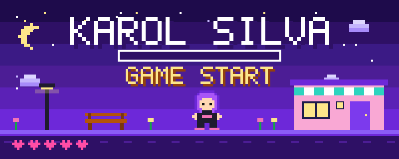

<svg xmlns="http://www.w3.org/2000/svg" viewBox="0 0 800 240" width="800" height="240" shape-rendering="crispEdges" xmlns:c2pa="http://c2pa.org/manifest"><metadata><c2pa:manifest>AAAWgmp1bWIAAAAeanVtZGMycGEAEQAQgAAAqgA4m3EDYzJwYQAAABZcanVtYgAAAEdqdW1kYzJtYQARABCAAACqADibcQN1cm46YzJwYTpmYjBlODRjNy0zZTIyLTRlYTUtOWY2Zi0zMzJlOTMyODFiY2QAAAADl2p1bWIAAAApanVtZGMyYXMAEQAQgAAAqgA4m3EDYzJwYS5hc3NlcnRpb25zAAAAALxqdW1iAAAARGp1bWRjYm9yABEAEIAAAKoAOJtxE2MycGEuaW5ncmVkaWVudC52MwAAAAAYYzJzaAMSLi1Q/TeEPruVwefilUEAAABwY2JvcqNpZGM6Zm9ybWF0bWltYWdlL3N2Zyt4bWxqaW5zdGFuY2VJRHgseG1wOmlpZDpkODkxY2Y2Ny04NDJiLTQxMzMtOTcwZC1jMTFlYWY1ZTg5MmFscmVsYXRpb25zaGlwaHBhcmVudE9mAAAB4mp1bWIAAABBanVtZGNib3IAEQAQgAAAqgA4m3ETYzJwYS5hY3Rpb25zLnYyAAAAABhjMnNo6+GPi/30pDM8nE4zZo9sPgAAAZljYm9yomdhY3Rpb25zgqJmYWN0aW9ua2MycGEub3BlbmVkanBhcmFtZXRlcnOha2luZ3JlZGllbnRzgaJjdXJseC1zZWxmI2p1bWJmPWMycGEuYXNzZXJ0aW9ucy9jMnBhLmluZ3JlZGllbnQudjNkaGFzaFggmp92fPNrg80mSl+uJKi7JHd4psAlLpH24KmIn08MtBakZmFjdGlvbngdY29tLmFudGhyb3BpYy5jbGF1ZGUucHJvdmlkZWRqcGFyYW1ldGVyc6F4H2NvbS5hbnRocm9waWMub3JpZ2luLWNvbmZpZGVuY2VndW5rbm93bmtkZXNjcmlwdGlvbnhmQ2xhdWRlIHByb3ZpZGVkIHRoaXMgZmlsZSBhdCB0aGUgcmVxdWVzdCBvZiBhIHVzZXIgYW5kIG1heSBoYXZlIGNyZWF0ZWQgb3IgbW9kaWZpZWQgdGhlIGZpbGUgY29udGVudHMubXNvZnR3YXJlQWdlbnShZG5hbWVmQ2xhdWRlcmFsbEFjdGlvbnNJbmNsdWRlZPUAAADIanVtYgAAAEBqdW1kY2JvcgARABCAAACqADibcRNjMnBhLmhhc2guZGF0YQAAAAAYYzJzaHksaErUexlf7ZwFco106TUAAACAY2JvcqVjYWxnZnNoYTI1NmNwYWRNAAAAAAAAAAAAAAAAAGRoYXNoWCC4V1wvu9+Fxz5lr28MYgge57Fsx6eJNG6olM7Hr8PDeWRuYW1lbmp1bWJmIG1hbmlmZXN0amV4Y2x1c2lvbnOBomVzdGFydBizZmxlbmd0aBkeBAAAAj5qdW1iAAAAJ2p1bWRjMmNsABEAEIAAAKoAOJtxA2MycGEuY2xhaW0udjIAAAACD2Nib3KlY2FsZ2ZzaGEyNTZpc2lnbmF0dXJleE1zZWxmI2p1bWJmPS9jMnBhL3VybjpjMnBhOmZiMGU4NGM3LTNlMjItNGVhNS05ZjZmLTMzMmU5MzI4MWJjZC9jMnBhLnNpZ25hdHVyZWppbnN0YW5jZUlEeCx4bXA6aWlkOmM4Zjc3NTFlLTNlNDQtNGU3ZS1hNzQ1LTMyNGVmN2IzNjYyM3JjcmVhdGVkX2Fzc2VydGlvbnODomN1cmx4LXNlbGYjanVtYmY9YzJwYS5hc3NlcnRpb25zL2MycGEuaW5ncmVkaWVudC52M2RoYXNoWCCan3Z882uDzSZKX64kqLskd3imwCUukfbgqYifTwy0FqJjdXJseCpzZWxmI2p1bWJmPWMycGEuYXNzZXJ0aW9ucy9jMnBhLmFjdGlvbnMudjJkaGFzaFggS/ie1QLdaGXt0yQntjY43ylHoxbU7ojYPoQVkR8FgkGiY3VybHgpc2VsZiNqdW1iZj1jMnBhLmFzc2VydGlvbnMvYzJwYS5oYXNoLmRhdGFkaGFzaFggFR82IbPV0bIsCHe84dZNJbe1YTm+jXgZP6U7UvcHsDt0Y2xhaW1fZ2VuZXJhdG9yX2luZm+jZG5hbWVvQW50aHJvcGljIEZpbGVzZ3ZlcnNpb25lMS4wLjBrc3BlY1ZlcnNpb25lMi40LjAAABA4anVtYgAAAChqdW1kYzJjcwARABCAAACqADibcQNjMnBhLnNpZ25hdHVyZQAAABAIY2JvctKEWQISogEmGCFZAgowggIGMIIBjaADAgECAhRA5aAK7sI50L64g/oGQgU9Z1UTADAKBggqhkjOPQQDAzBJMRcwFQYDVQQKEw5BbnRocm9waWMsIFBCQzEuMCwGA1UEAxMlQW50aHJvcGljIENvbnRlbnQgQ3JlZGVudGlhbHMgUm9vdCBDQTAeFw0yNjA4MDcxODQzNTZaFw0yODA4MDYxOTQzNTZaMEQxFzAVBgNVBAoTDkFudGhyb3BpYywgUEJDMSkwJwYDVQQDEyBBbnRocm9waWMgQ2xhdWRlIENvbnRlbnQgU2lnbmluZzBZMBMGByqGSM49AgEGCCqGSM49AwEHA0IABJh6CmvLUBgFFNU0vUKlOVtE6djd17L5SuwX0LemFisBM3dkd/3cyjxFA3Qo5S46fX0/ihY0VZ7mfb9KF703t5OjWDBWMA4GA1UdDwEB/wQEAwIHgDAVBgNVHSUEDjAMBgorBgEEAYPoXgIBMAwGA1UdEwEB/wQCMAAwHwYDVR0jBBgwFoAUzlHiBIFOZFsj+OPEz5o+nMHXXMIwCgYIKoZIzj0EAwMDZwAwZAIwMXMdFJ4BetLLVY7ORuE9noqbbAZOZn/aArXyTwFAZfKrPzxF2vPoJNf1+UCdg1XGAjBwX1zd9WGqYkqmL5SFqw1QySjr1zJfpJM9+1rdDwSPLMOPOjKuiXjoU/pUUeG9RwmhY3BhZFkNngAAAAAAAAAAAAAAAAAAAAAAAAAAAAAAAAAAAAAAAAAAAAAAAAAAAAAAAAAAAAAAAAAAAAAAAAAAAAAAAAAAAAAAAAAAAAAAAAAAAAAAAAAAAAAAAAAAAAAAAAAAAAAAAAAAAAAAAAAAAAAAAAAAAAAAAAAAAAAAAAAAAAAAAAAAAAAAAAAAAAAAAAAAAAAAAAAAAAAAAAAAAAAAAAAAAAAAAAAAAAAAAAAAAAAAAAAAAAAAAAAAAAAAAAAAAAAAAAAAAAAAAAAAAAAAAAAAAAAAAAAAAAAAAAAAAAAAAAAAAAAAAAAAAAAAAAAAAAAAAAAAAAAAAAAAAAAAAAAAAAAAAAAAAAAAAAAAAAAAAAAAAAAAAAAAAAAAAAAAAAAAAAAAAAAAAAAAAAAAAAAAAAAAAAAAAAAAAAAAAAAAAAAAAAAAAAAAAAAAAAAAAAAAAAAAAAAAAAAAAAAAAAAAAAAAAAAAAAAAAAAAAAAAAAAAAAAAAAAAAAAAAAAAAAAAAAAAAAAAAAAAAAAAAAAAAAAAAAAAAAAAAAAAAAAAAAAAAAAAAAAAAAAAAAAAAAAAAAAAAAAAAAAAAAAAAAAAAAAAAAAAAAAAAAAAAAAAAAAAAAAAAAAAAAAAAAAAAAAAAAAAAAAAAAAAAAAAAAAAAAAAAAAAAAAAAAAAAAAAAAAAAAAAAAAAAAAAAAAAAAAAAAAAAAAAAAAAAAAAAAAAAAAAAAAAAAAAAAAAAAAAAAAAAAAAAAAAAAAAAAAAAAAAAAAAAAAAAAAAAAAAAAAAAAAAAAAAAAAAAAAAAAAAAAAAAAAAAAAAAAAAAAAAAAAAAAAAAAAAAAAAAAAAAAAAAAAAAAAAAAAAAAAAAAAAAAAAAAAAAAAAAAAAAAAAAAAAAAAAAAAAAAAAAAAAAAAAAAAAAAAAAAAAAAAAAAAAAAAAAAAAAAAAAAAAAAAAAAAAAAAAAAAAAAAAAAAAAAAAAAAAAAAAAAAAAAAAAAAAAAAAAAAAAAAAAAAAAAAAAAAAAAAAAAAAAAAAAAAAAAAAAAAAAAAAAAAAAAAAAAAAAAAAAAAAAAAAAAAAAAAAAAAAAAAAAAAAAAAAAAAAAAAAAAAAAAAAAAAAAAAAAAAAAAAAAAAAAAAAAAAAAAAAAAAAAAAAAAAAAAAAAAAAAAAAAAAAAAAAAAAAAAAAAAAAAAAAAAAAAAAAAAAAAAAAAAAAAAAAAAAAAAAAAAAAAAAAAAAAAAAAAAAAAAAAAAAAAAAAAAAAAAAAAAAAAAAAAAAAAAAAAAAAAAAAAAAAAAAAAAAAAAAAAAAAAAAAAAAAAAAAAAAAAAAAAAAAAAAAAAAAAAAAAAAAAAAAAAAAAAAAAAAAAAAAAAAAAAAAAAAAAAAAAAAAAAAAAAAAAAAAAAAAAAAAAAAAAAAAAAAAAAAAAAAAAAAAAAAAAAAAAAAAAAAAAAAAAAAAAAAAAAAAAAAAAAAAAAAAAAAAAAAAAAAAAAAAAAAAAAAAAAAAAAAAAAAAAAAAAAAAAAAAAAAAAAAAAAAAAAAAAAAAAAAAAAAAAAAAAAAAAAAAAAAAAAAAAAAAAAAAAAAAAAAAAAAAAAAAAAAAAAAAAAAAAAAAAAAAAAAAAAAAAAAAAAAAAAAAAAAAAAAAAAAAAAAAAAAAAAAAAAAAAAAAAAAAAAAAAAAAAAAAAAAAAAAAAAAAAAAAAAAAAAAAAAAAAAAAAAAAAAAAAAAAAAAAAAAAAAAAAAAAAAAAAAAAAAAAAAAAAAAAAAAAAAAAAAAAAAAAAAAAAAAAAAAAAAAAAAAAAAAAAAAAAAAAAAAAAAAAAAAAAAAAAAAAAAAAAAAAAAAAAAAAAAAAAAAAAAAAAAAAAAAAAAAAAAAAAAAAAAAAAAAAAAAAAAAAAAAAAAAAAAAAAAAAAAAAAAAAAAAAAAAAAAAAAAAAAAAAAAAAAAAAAAAAAAAAAAAAAAAAAAAAAAAAAAAAAAAAAAAAAAAAAAAAAAAAAAAAAAAAAAAAAAAAAAAAAAAAAAAAAAAAAAAAAAAAAAAAAAAAAAAAAAAAAAAAAAAAAAAAAAAAAAAAAAAAAAAAAAAAAAAAAAAAAAAAAAAAAAAAAAAAAAAAAAAAAAAAAAAAAAAAAAAAAAAAAAAAAAAAAAAAAAAAAAAAAAAAAAAAAAAAAAAAAAAAAAAAAAAAAAAAAAAAAAAAAAAAAAAAAAAAAAAAAAAAAAAAAAAAAAAAAAAAAAAAAAAAAAAAAAAAAAAAAAAAAAAAAAAAAAAAAAAAAAAAAAAAAAAAAAAAAAAAAAAAAAAAAAAAAAAAAAAAAAAAAAAAAAAAAAAAAAAAAAAAAAAAAAAAAAAAAAAAAAAAAAAAAAAAAAAAAAAAAAAAAAAAAAAAAAAAAAAAAAAAAAAAAAAAAAAAAAAAAAAAAAAAAAAAAAAAAAAAAAAAAAAAAAAAAAAAAAAAAAAAAAAAAAAAAAAAAAAAAAAAAAAAAAAAAAAAAAAAAAAAAAAAAAAAAAAAAAAAAAAAAAAAAAAAAAAAAAAAAAAAAAAAAAAAAAAAAAAAAAAAAAAAAAAAAAAAAAAAAAAAAAAAAAAAAAAAAAAAAAAAAAAAAAAAAAAAAAAAAAAAAAAAAAAAAAAAAAAAAAAAAAAAAAAAAAAAAAAAAAAAAAAAAAAAAAAAAAAAAAAAAAAAAAAAAAAAAAAAAAAAAAAAAAAAAAAAAAAAAAAAAAAAAAAAAAAAAAAAAAAAAAAAAAAAAAAAAAAAAAAAAAAAAAAAAAAAAAAAAAAAAAAAAAAAAAAAAAAAAAAAAAAAAAAAAAAAAAAAAAAAAAAAAAAAAAAAAAAAAAAAAAAAAAAAAAAAAAAAAAAAAAAAAAAAAAAAAAAAAAAAAAAAAAAAAAAAAAAAAAAAAAAAAAAAAAAAAAAAAAAAAAAAAAAAAAAAAAAAAAAAAAAAAAAAAAAAAAAAAAAAAAAAAAAAAAAAAAAAAAAAAAAAAAAAAAAAAAAAAAAAAAAAAAAAAAAAAAAAAAAAAAAAAAAAAAAAAAAAAAAAAAAAAAAAAAAAAAAAAAAAAAAAAAAAAAAAAAAAAAAAAAAAAAAAAAAAAAAAAAAAAAAAAAAAAAAAAAAAAAAAAAAAAAAAAAAAAAAAAAAAAAAAAAAAAAAAAAAAAAAAAAAAAAAAAAAAAAAAAAAAAAAAAAAAAAAAAAAAAAAAAAAAAAAAAAAAAAAAAAAAAAAAAAAAAAAAAAAAAAAAAAAAAAAAAAAAAAAAAAAAAAAAAAAAAAAAAAAAAAAAAAAAAAAAAAAAAAAAAAAAAAAAAAAAAAAAAAAAAAAAAAAAAAAAAAAAAAAAAAAAAAAAAAAAAAAAAAAAAAAAAAAAAAAAAAAAAAAAAAAAAAAAAAAAAAAAAAAAAAAAAAAAAAAAAAAAAAAAAAAAAAAAAAAAAAAAAAAAAAAAAAAAAAAAAAAAAAAAAAAAAAAAAAAAAAAAAAAAAAAAAAAAAAAAAAAAAAAAAAAAAAAAAAAAAAAAAAAAAAAAAAAAAAAAAAAAAAAAAAAAAAAAAAAAAAAAAAAAAAAAAAAAAAAAAAAAAAAAAAAAAAAAAAAAAAAAAAAAAAAAAAAAAAAAAAAAAAAAAAAAAAAAAAAAAAAAAAAAAAAAAAAAAAAAAAAAAAAAAAAAAAAAAAAAAAAAAAAAAAAAAAAAAAAAAAAAAAAAAAAAAAAAAAAAAAAAAAAAAAAAAAAAAAAAAAAAAAAAAAAAAAAAAAAAAAAAAAAAAAAAAAAAAAAAAAAAAAAAAAAAAAAAAAAAAAAAAAAAAAAAAAAAAAAAAAAAAAAAAAAAAAAAAAAAAAAAAAAAAAAAAAAAAAAAAAAAAAAAAAAAAAAAAAAAAAAAAAAAAAAAAAAAAAAAAAAAAAAAAAAAAAAAAAAAAAAAAAAAAAAAAAAAAAAAAAAAAAAAAAAAAAAAAAAAAAAAAAAAAAAAAAAAAAAAAAAAAAAAAAAAAAAAAAAAAAAAAAAAAAAAAAAAAAAAAAAAAAAAAAAAAAAAAAAAAAAAAAAAAAAAAAAAAAAAAAAAAAAAAAAAAAAAAAAAAAAAAAAAAAAAAAAAAAAAAAAAAAAAAAAAAAAAAAAAAAAAAAAAAAAAAAAAAAAAAAAAAAAAAAAAAAAAAAAAAAAAAAAAAAAAAAAAAAAAAAAAAAAAAAAAAAAAAAAAAAAAAAAAAAAAAAAAAAAAAAAAAAAAAAAAAAAAAAAAAAAAAAAAAAAAAAAAAAAAAAAAAAAAAAAAAAAAAAAAAAAAAAAAAAAAAAAAAAAAAAAAAAAAAAAAAAAAAAAAAAAAAAAAAAAAAAAAAAAAAAAAAAAAAAAAAAAAAAAAAAAAAAAAAAAAAAAAAAAAAAAAAAAAAAAAAAAAAAAAAAAAAAAAAAAAAAAAAAAAAAAAAAAAAAAAAAAAAAAAAAAAAAAAAAAAAAAAAAAAAAAAAAAAAAAAAAAAAAAAAAAAAAAAAAAAAAAAAAAAAAAAAAAAAAAAAAAAAAAAAAAAAAAAAAAAAAAAAAAAAAAAAAAAAAAAAAAAAAAAAAAAAAAAAAAAAAAAAAAAAAAAAAAAAAAAAAAAAAAAAAAAAAAAAAAAAAAAAAAAAAAAAAAAAAAAAAAAAAAAAAAAAAAAAAAAAAAAAAAAAPZYQBM/KW+1e6DNmWbGwvW2MvpeHQ1oPW78fJJFra84j1Z0kjo91gVmbHZh96FDHRSulvhLu6htMES50eX0kKqWFvI=</c2pa:manifest></metadata>
<rect width="800" height="240" fill="#0B0614"/>
<rect x="8" y="8" width="784" height="224" fill="none" stroke="#7C3AED" stroke-width="8"/>
<rect x="20" y="20" width="760" height="200" fill="none" stroke="#2E1065" stroke-width="4"/>
<rect x="416" y="176" width="4" height="4" fill="#4C1D95"><animate attributeName="opacity" values="1;0.2;1" dur="1.6s" repeatCount="indefinite"/></rect>
<rect x="560" y="40" width="4" height="4" fill="#C084FC"><animate attributeName="opacity" values="1;0.2;1" dur="2.7s" repeatCount="indefinite"/></rect>
<rect x="48" y="32" width="4" height="4" fill="#FFFFFF"><animate attributeName="opacity" values="1;0.2;1" dur="2.3s" repeatCount="indefinite"/></rect>
<rect x="256" y="32" width="4" height="4" fill="#FFFFFF"><animate attributeName="opacity" values="1;0.2;1" dur="1.6s" repeatCount="indefinite"/></rect>
<rect x="592" y="40" width="4" height="4" fill="#7C3AED"><animate attributeName="opacity" values="1;0.2;1" dur="2.8s" repeatCount="indefinite"/></rect>
<rect x="608" y="24" width="4" height="4" fill="#FFFFFF"><animate attributeName="opacity" values="1;0.2;1" dur="1.6s" repeatCount="indefinite"/></rect>
<rect x="240" y="24" width="4" height="4" fill="#7C3AED"><animate attributeName="opacity" values="1;0.2;1" dur="2.1s" repeatCount="indefinite"/></rect>
<rect x="160" y="152" width="4" height="4" fill="#4C1D95"><animate attributeName="opacity" values="1;0.2;1" dur="2.6s" repeatCount="indefinite"/></rect>
<rect x="584" y="184" width="4" height="4" fill="#7C3AED"><animate attributeName="opacity" values="1;0.2;1" dur="1.7s" repeatCount="indefinite"/></rect>
<rect x="600" y="176" width="4" height="4" fill="#7C3AED"><animate attributeName="opacity" values="1;0.2;1" dur="2.2s" repeatCount="indefinite"/></rect>
<rect x="576" y="192" width="4" height="4" fill="#4C1D95"><animate attributeName="opacity" values="1;0.2;1" dur="2.6s" repeatCount="indefinite"/></rect>
<rect x="520" y="184" width="4" height="4" fill="#FFFFFF"><animate attributeName="opacity" values="1;0.2;1" dur="3.1s" repeatCount="indefinite"/></rect>
<rect x="488" y="160" width="4" height="4" fill="#FFFFFF"><animate attributeName="opacity" values="1;0.2;1" dur="2.2s" repeatCount="indefinite"/></rect>
<rect x="264" y="216" width="4" height="4" fill="#7C3AED"><animate attributeName="opacity" values="1;0.2;1" dur="2.9s" repeatCount="indefinite"/></rect>
<rect x="264" y="32" width="4" height="4" fill="#C084FC"><animate attributeName="opacity" values="1;0.2;1" dur="2.6s" repeatCount="indefinite"/></rect>
<rect x="360" y="200" width="4" height="4" fill="#FFFFFF"><animate attributeName="opacity" values="1;0.2;1" dur="2.1s" repeatCount="indefinite"/></rect>
<rect x="88" y="40" width="4" height="4" fill="#FFFFFF"><animate attributeName="opacity" values="1;0.2;1" dur="1.8s" repeatCount="indefinite"/></rect>
<rect x="512" y="120" width="4" height="4" fill="#4C1D95"><animate attributeName="opacity" values="1;0.2;1" dur="3.4s" repeatCount="indefinite"/></rect>
<rect x="88" y="208" width="4" height="4" fill="#C084FC"><animate attributeName="opacity" values="1;0.2;1" dur="2.2s" repeatCount="indefinite"/></rect>
<rect x="368" y="168" width="4" height="4" fill="#FFFFFF"><animate attributeName="opacity" values="1;0.2;1" dur="2.7s" repeatCount="indefinite"/></rect>
<rect x="480" y="32" width="4" height="4" fill="#4C1D95"><animate attributeName="opacity" values="1;0.2;1" dur="3.4s" repeatCount="indefinite"/></rect>
<rect x="496" y="192" width="4" height="4" fill="#4C1D95"><animate attributeName="opacity" values="1;0.2;1" dur="1.6s" repeatCount="indefinite"/></rect>
<rect x="304" y="192" width="4" height="4" fill="#FFFFFF"><animate attributeName="opacity" values="1;0.2;1" dur="3.3s" repeatCount="indefinite"/></rect>
<rect x="368" y="16" width="4" height="4" fill="#FFFFFF"><animate attributeName="opacity" values="1;0.2;1" dur="2.2s" repeatCount="indefinite"/></rect>
<rect x="640" y="40" width="4" height="4" fill="#FFFFFF"><animate attributeName="opacity" values="1;0.2;1" dur="1.6s" repeatCount="indefinite"/></rect>
<rect x="520" y="32" width="4" height="4" fill="#7C3AED"><animate attributeName="opacity" values="1;0.2;1" dur="2.4s" repeatCount="indefinite"/></rect>
<rect x="152" y="120" width="4" height="4" fill="#C084FC"><animate attributeName="opacity" values="1;0.2;1" dur="2.9s" repeatCount="indefinite"/></rect>
<rect x="376" y="184" width="4" height="4" fill="#FFFFFF"><animate attributeName="opacity" values="1;0.2;1" dur="3.4s" repeatCount="indefinite"/></rect>
<rect x="168" y="32" width="4" height="4" fill="#7C3AED"><animate attributeName="opacity" values="1;0.2;1" dur="1.8s" repeatCount="indefinite"/></rect>
<rect x="24" y="136" width="4" height="4" fill="#7C3AED"><animate attributeName="opacity" values="1;0.2;1" dur="2.0s" repeatCount="indefinite"/></rect>
<rect x="440" y="152" width="4" height="4" fill="#C084FC"><animate attributeName="opacity" values="1;0.2;1" dur="2.7s" repeatCount="indefinite"/></rect>
<rect x="52" y="60" width="8" height="8" fill="#4C1D95"/>
<rect x="84" y="60" width="8" height="8" fill="#4C1D95"/>
<rect x="52" y="68" width="8" height="8" fill="#4C1D95"/>
<rect x="76" y="68" width="8" height="8" fill="#4C1D95"/>
<rect x="52" y="76" width="8" height="8" fill="#4C1D95"/>
<rect x="68" y="76" width="8" height="8" fill="#4C1D95"/>
<rect x="52" y="84" width="8" height="8" fill="#4C1D95"/>
<rect x="60" y="84" width="8" height="8" fill="#4C1D95"/>
<rect x="52" y="92" width="8" height="8" fill="#4C1D95"/>
<rect x="68" y="92" width="8" height="8" fill="#4C1D95"/>
<rect x="52" y="100" width="8" height="8" fill="#4C1D95"/>
<rect x="76" y="100" width="8" height="8" fill="#4C1D95"/>
<rect x="52" y="108" width="8" height="8" fill="#4C1D95"/>
<rect x="84" y="108" width="8" height="8" fill="#4C1D95"/>
<rect x="108" y="60" width="8" height="8" fill="#4C1D95"/>
<rect x="116" y="60" width="8" height="8" fill="#4C1D95"/>
<rect x="124" y="60" width="8" height="8" fill="#4C1D95"/>
<rect x="100" y="68" width="8" height="8" fill="#4C1D95"/>
<rect x="132" y="68" width="8" height="8" fill="#4C1D95"/>
<rect x="100" y="76" width="8" height="8" fill="#4C1D95"/>
<rect x="132" y="76" width="8" height="8" fill="#4C1D95"/>
<rect x="100" y="84" width="8" height="8" fill="#4C1D95"/>
<rect x="108" y="84" width="8" height="8" fill="#4C1D95"/>
<rect x="116" y="84" width="8" height="8" fill="#4C1D95"/>
<rect x="124" y="84" width="8" height="8" fill="#4C1D95"/>
<rect x="132" y="84" width="8" height="8" fill="#4C1D95"/>
<rect x="100" y="92" width="8" height="8" fill="#4C1D95"/>
<rect x="132" y="92" width="8" height="8" fill="#4C1D95"/>
<rect x="100" y="100" width="8" height="8" fill="#4C1D95"/>
<rect x="132" y="100" width="8" height="8" fill="#4C1D95"/>
<rect x="100" y="108" width="8" height="8" fill="#4C1D95"/>
<rect x="132" y="108" width="8" height="8" fill="#4C1D95"/>
<rect x="148" y="60" width="8" height="8" fill="#4C1D95"/>
<rect x="156" y="60" width="8" height="8" fill="#4C1D95"/>
<rect x="164" y="60" width="8" height="8" fill="#4C1D95"/>
<rect x="172" y="60" width="8" height="8" fill="#4C1D95"/>
<rect x="148" y="68" width="8" height="8" fill="#4C1D95"/>
<rect x="180" y="68" width="8" height="8" fill="#4C1D95"/>
<rect x="148" y="76" width="8" height="8" fill="#4C1D95"/>
<rect x="180" y="76" width="8" height="8" fill="#4C1D95"/>
<rect x="148" y="84" width="8" height="8" fill="#4C1D95"/>
<rect x="156" y="84" width="8" height="8" fill="#4C1D95"/>
<rect x="164" y="84" width="8" height="8" fill="#4C1D95"/>
<rect x="172" y="84" width="8" height="8" fill="#4C1D95"/>
<rect x="148" y="92" width="8" height="8" fill="#4C1D95"/>
<rect x="164" y="92" width="8" height="8" fill="#4C1D95"/>
<rect x="148" y="100" width="8" height="8" fill="#4C1D95"/>
<rect x="172" y="100" width="8" height="8" fill="#4C1D95"/>
<rect x="148" y="108" width="8" height="8" fill="#4C1D95"/>
<rect x="180" y="108" width="8" height="8" fill="#4C1D95"/>
<rect x="204" y="60" width="8" height="8" fill="#4C1D95"/>
<rect x="212" y="60" width="8" height="8" fill="#4C1D95"/>
<rect x="220" y="60" width="8" height="8" fill="#4C1D95"/>
<rect x="196" y="68" width="8" height="8" fill="#4C1D95"/>
<rect x="228" y="68" width="8" height="8" fill="#4C1D95"/>
<rect x="196" y="76" width="8" height="8" fill="#4C1D95"/>
<rect x="228" y="76" width="8" height="8" fill="#4C1D95"/>
<rect x="196" y="84" width="8" height="8" fill="#4C1D95"/>
<rect x="228" y="84" width="8" height="8" fill="#4C1D95"/>
<rect x="196" y="92" width="8" height="8" fill="#4C1D95"/>
<rect x="228" y="92" width="8" height="8" fill="#4C1D95"/>
<rect x="196" y="100" width="8" height="8" fill="#4C1D95"/>
<rect x="228" y="100" width="8" height="8" fill="#4C1D95"/>
<rect x="204" y="108" width="8" height="8" fill="#4C1D95"/>
<rect x="212" y="108" width="8" height="8" fill="#4C1D95"/>
<rect x="220" y="108" width="8" height="8" fill="#4C1D95"/>
<rect x="244" y="60" width="8" height="8" fill="#4C1D95"/>
<rect x="244" y="68" width="8" height="8" fill="#4C1D95"/>
<rect x="244" y="76" width="8" height="8" fill="#4C1D95"/>
<rect x="244" y="84" width="8" height="8" fill="#4C1D95"/>
<rect x="244" y="92" width="8" height="8" fill="#4C1D95"/>
<rect x="244" y="100" width="8" height="8" fill="#4C1D95"/>
<rect x="244" y="108" width="8" height="8" fill="#4C1D95"/>
<rect x="252" y="108" width="8" height="8" fill="#4C1D95"/>
<rect x="260" y="108" width="8" height="8" fill="#4C1D95"/>
<rect x="268" y="108" width="8" height="8" fill="#4C1D95"/>
<rect x="276" y="108" width="8" height="8" fill="#4C1D95"/>
<rect x="348" y="60" width="8" height="8" fill="#4C1D95"/>
<rect x="356" y="60" width="8" height="8" fill="#4C1D95"/>
<rect x="364" y="60" width="8" height="8" fill="#4C1D95"/>
<rect x="372" y="60" width="8" height="8" fill="#4C1D95"/>
<rect x="340" y="68" width="8" height="8" fill="#4C1D95"/>
<rect x="340" y="76" width="8" height="8" fill="#4C1D95"/>
<rect x="348" y="84" width="8" height="8" fill="#4C1D95"/>
<rect x="356" y="84" width="8" height="8" fill="#4C1D95"/>
<rect x="364" y="84" width="8" height="8" fill="#4C1D95"/>
<rect x="372" y="92" width="8" height="8" fill="#4C1D95"/>
<rect x="372" y="100" width="8" height="8" fill="#4C1D95"/>
<rect x="340" y="108" width="8" height="8" fill="#4C1D95"/>
<rect x="348" y="108" width="8" height="8" fill="#4C1D95"/>
<rect x="356" y="108" width="8" height="8" fill="#4C1D95"/>
<rect x="364" y="108" width="8" height="8" fill="#4C1D95"/>
<rect x="396" y="60" width="8" height="8" fill="#4C1D95"/>
<rect x="404" y="60" width="8" height="8" fill="#4C1D95"/>
<rect x="412" y="60" width="8" height="8" fill="#4C1D95"/>
<rect x="404" y="68" width="8" height="8" fill="#4C1D95"/>
<rect x="404" y="76" width="8" height="8" fill="#4C1D95"/>
<rect x="404" y="84" width="8" height="8" fill="#4C1D95"/>
<rect x="404" y="92" width="8" height="8" fill="#4C1D95"/>
<rect x="404" y="100" width="8" height="8" fill="#4C1D95"/>
<rect x="396" y="108" width="8" height="8" fill="#4C1D95"/>
<rect x="404" y="108" width="8" height="8" fill="#4C1D95"/>
<rect x="412" y="108" width="8" height="8" fill="#4C1D95"/>
<rect x="436" y="60" width="8" height="8" fill="#4C1D95"/>
<rect x="436" y="68" width="8" height="8" fill="#4C1D95"/>
<rect x="436" y="76" width="8" height="8" fill="#4C1D95"/>
<rect x="436" y="84" width="8" height="8" fill="#4C1D95"/>
<rect x="436" y="92" width="8" height="8" fill="#4C1D95"/>
<rect x="436" y="100" width="8" height="8" fill="#4C1D95"/>
<rect x="436" y="108" width="8" height="8" fill="#4C1D95"/>
<rect x="444" y="108" width="8" height="8" fill="#4C1D95"/>
<rect x="452" y="108" width="8" height="8" fill="#4C1D95"/>
<rect x="460" y="108" width="8" height="8" fill="#4C1D95"/>
<rect x="468" y="108" width="8" height="8" fill="#4C1D95"/>
<rect x="484" y="60" width="8" height="8" fill="#4C1D95"/>
<rect x="516" y="60" width="8" height="8" fill="#4C1D95"/>
<rect x="484" y="68" width="8" height="8" fill="#4C1D95"/>
<rect x="516" y="68" width="8" height="8" fill="#4C1D95"/>
<rect x="484" y="76" width="8" height="8" fill="#4C1D95"/>
<rect x="516" y="76" width="8" height="8" fill="#4C1D95"/>
<rect x="484" y="84" width="8" height="8" fill="#4C1D95"/>
<rect x="516" y="84" width="8" height="8" fill="#4C1D95"/>
<rect x="484" y="92" width="8" height="8" fill="#4C1D95"/>
<rect x="516" y="92" width="8" height="8" fill="#4C1D95"/>
<rect x="492" y="100" width="8" height="8" fill="#4C1D95"/>
<rect x="508" y="100" width="8" height="8" fill="#4C1D95"/>
<rect x="500" y="108" width="8" height="8" fill="#4C1D95"/>
<rect x="540" y="60" width="8" height="8" fill="#4C1D95"/>
<rect x="548" y="60" width="8" height="8" fill="#4C1D95"/>
<rect x="556" y="60" width="8" height="8" fill="#4C1D95"/>
<rect x="532" y="68" width="8" height="8" fill="#4C1D95"/>
<rect x="564" y="68" width="8" height="8" fill="#4C1D95"/>
<rect x="532" y="76" width="8" height="8" fill="#4C1D95"/>
<rect x="564" y="76" width="8" height="8" fill="#4C1D95"/>
<rect x="532" y="84" width="8" height="8" fill="#4C1D95"/>
<rect x="540" y="84" width="8" height="8" fill="#4C1D95"/>
<rect x="548" y="84" width="8" height="8" fill="#4C1D95"/>
<rect x="556" y="84" width="8" height="8" fill="#4C1D95"/>
<rect x="564" y="84" width="8" height="8" fill="#4C1D95"/>
<rect x="532" y="92" width="8" height="8" fill="#4C1D95"/>
<rect x="564" y="92" width="8" height="8" fill="#4C1D95"/>
<rect x="532" y="100" width="8" height="8" fill="#4C1D95"/>
<rect x="564" y="100" width="8" height="8" fill="#4C1D95"/>
<rect x="532" y="108" width="8" height="8" fill="#4C1D95"/>
<rect x="564" y="108" width="8" height="8" fill="#4C1D95"/>
<rect x="44" y="52" width="8" height="8" fill="#C084FC"/>
<rect x="76" y="52" width="8" height="8" fill="#C084FC"/>
<rect x="44" y="60" width="8" height="8" fill="#C084FC"/>
<rect x="68" y="60" width="8" height="8" fill="#C084FC"/>
<rect x="44" y="68" width="8" height="8" fill="#C084FC"/>
<rect x="60" y="68" width="8" height="8" fill="#C084FC"/>
<rect x="44" y="76" width="8" height="8" fill="#C084FC"/>
<rect x="52" y="76" width="8" height="8" fill="#C084FC"/>
<rect x="44" y="84" width="8" height="8" fill="#C084FC"/>
<rect x="60" y="84" width="8" height="8" fill="#C084FC"/>
<rect x="44" y="92" width="8" height="8" fill="#C084FC"/>
<rect x="68" y="92" width="8" height="8" fill="#C084FC"/>
<rect x="44" y="100" width="8" height="8" fill="#C084FC"/>
<rect x="76" y="100" width="8" height="8" fill="#C084FC"/>
<rect x="100" y="52" width="8" height="8" fill="#C084FC"/>
<rect x="108" y="52" width="8" height="8" fill="#C084FC"/>
<rect x="116" y="52" width="8" height="8" fill="#C084FC"/>
<rect x="92" y="60" width="8" height="8" fill="#C084FC"/>
<rect x="124" y="60" width="8" height="8" fill="#C084FC"/>
<rect x="92" y="68" width="8" height="8" fill="#C084FC"/>
<rect x="124" y="68" width="8" height="8" fill="#C084FC"/>
<rect x="92" y="76" width="8" height="8" fill="#C084FC"/>
<rect x="100" y="76" width="8" height="8" fill="#C084FC"/>
<rect x="108" y="76" width="8" height="8" fill="#C084FC"/>
<rect x="116" y="76" width="8" height="8" fill="#C084FC"/>
<rect x="124" y="76" width="8" height="8" fill="#C084FC"/>
<rect x="92" y="84" width="8" height="8" fill="#C084FC"/>
<rect x="124" y="84" width="8" height="8" fill="#C084FC"/>
<rect x="92" y="92" width="8" height="8" fill="#C084FC"/>
<rect x="124" y="92" width="8" height="8" fill="#C084FC"/>
<rect x="92" y="100" width="8" height="8" fill="#C084FC"/>
<rect x="124" y="100" width="8" height="8" fill="#C084FC"/>
<rect x="140" y="52" width="8" height="8" fill="#C084FC"/>
<rect x="148" y="52" width="8" height="8" fill="#C084FC"/>
<rect x="156" y="52" width="8" height="8" fill="#C084FC"/>
<rect x="164" y="52" width="8" height="8" fill="#C084FC"/>
<rect x="140" y="60" width="8" height="8" fill="#C084FC"/>
<rect x="172" y="60" width="8" height="8" fill="#C084FC"/>
<rect x="140" y="68" width="8" height="8" fill="#C084FC"/>
<rect x="172" y="68" width="8" height="8" fill="#C084FC"/>
<rect x="140" y="76" width="8" height="8" fill="#C084FC"/>
<rect x="148" y="76" width="8" height="8" fill="#C084FC"/>
<rect x="156" y="76" width="8" height="8" fill="#C084FC"/>
<rect x="164" y="76" width="8" height="8" fill="#C084FC"/>
<rect x="140" y="84" width="8" height="8" fill="#C084FC"/>
<rect x="156" y="84" width="8" height="8" fill="#C084FC"/>
<rect x="140" y="92" width="8" height="8" fill="#C084FC"/>
<rect x="164" y="92" width="8" height="8" fill="#C084FC"/>
<rect x="140" y="100" width="8" height="8" fill="#C084FC"/>
<rect x="172" y="100" width="8" height="8" fill="#C084FC"/>
<rect x="196" y="52" width="8" height="8" fill="#C084FC"/>
<rect x="204" y="52" width="8" height="8" fill="#C084FC"/>
<rect x="212" y="52" width="8" height="8" fill="#C084FC"/>
<rect x="188" y="60" width="8" height="8" fill="#C084FC"/>
<rect x="220" y="60" width="8" height="8" fill="#C084FC"/>
<rect x="188" y="68" width="8" height="8" fill="#C084FC"/>
<rect x="220" y="68" width="8" height="8" fill="#C084FC"/>
<rect x="188" y="76" width="8" height="8" fill="#C084FC"/>
<rect x="220" y="76" width="8" height="8" fill="#C084FC"/>
<rect x="188" y="84" width="8" height="8" fill="#C084FC"/>
<rect x="220" y="84" width="8" height="8" fill="#C084FC"/>
<rect x="188" y="92" width="8" height="8" fill="#C084FC"/>
<rect x="220" y="92" width="8" height="8" fill="#C084FC"/>
<rect x="196" y="100" width="8" height="8" fill="#C084FC"/>
<rect x="204" y="100" width="8" height="8" fill="#C084FC"/>
<rect x="212" y="100" width="8" height="8" fill="#C084FC"/>
<rect x="236" y="52" width="8" height="8" fill="#C084FC"/>
<rect x="236" y="60" width="8" height="8" fill="#C084FC"/>
<rect x="236" y="68" width="8" height="8" fill="#C084FC"/>
<rect x="236" y="76" width="8" height="8" fill="#C084FC"/>
<rect x="236" y="84" width="8" height="8" fill="#C084FC"/>
<rect x="236" y="92" width="8" height="8" fill="#C084FC"/>
<rect x="236" y="100" width="8" height="8" fill="#C084FC"/>
<rect x="244" y="100" width="8" height="8" fill="#C084FC"/>
<rect x="252" y="100" width="8" height="8" fill="#C084FC"/>
<rect x="260" y="100" width="8" height="8" fill="#C084FC"/>
<rect x="268" y="100" width="8" height="8" fill="#C084FC"/>
<rect x="340" y="52" width="8" height="8" fill="#C084FC"/>
<rect x="348" y="52" width="8" height="8" fill="#C084FC"/>
<rect x="356" y="52" width="8" height="8" fill="#C084FC"/>
<rect x="364" y="52" width="8" height="8" fill="#C084FC"/>
<rect x="332" y="60" width="8" height="8" fill="#C084FC"/>
<rect x="332" y="68" width="8" height="8" fill="#C084FC"/>
<rect x="340" y="76" width="8" height="8" fill="#C084FC"/>
<rect x="348" y="76" width="8" height="8" fill="#C084FC"/>
<rect x="356" y="76" width="8" height="8" fill="#C084FC"/>
<rect x="364" y="84" width="8" height="8" fill="#C084FC"/>
<rect x="364" y="92" width="8" height="8" fill="#C084FC"/>
<rect x="332" y="100" width="8" height="8" fill="#C084FC"/>
<rect x="340" y="100" width="8" height="8" fill="#C084FC"/>
<rect x="348" y="100" width="8" height="8" fill="#C084FC"/>
<rect x="356" y="100" width="8" height="8" fill="#C084FC"/>
<rect x="388" y="52" width="8" height="8" fill="#C084FC"/>
<rect x="396" y="52" width="8" height="8" fill="#C084FC"/>
<rect x="404" y="52" width="8" height="8" fill="#C084FC"/>
<rect x="396" y="60" width="8" height="8" fill="#C084FC"/>
<rect x="396" y="68" width="8" height="8" fill="#C084FC"/>
<rect x="396" y="76" width="8" height="8" fill="#C084FC"/>
<rect x="396" y="84" width="8" height="8" fill="#C084FC"/>
<rect x="396" y="92" width="8" height="8" fill="#C084FC"/>
<rect x="388" y="100" width="8" height="8" fill="#C084FC"/>
<rect x="396" y="100" width="8" height="8" fill="#C084FC"/>
<rect x="404" y="100" width="8" height="8" fill="#C084FC"/>
<rect x="428" y="52" width="8" height="8" fill="#C084FC"/>
<rect x="428" y="60" width="8" height="8" fill="#C084FC"/>
<rect x="428" y="68" width="8" height="8" fill="#C084FC"/>
<rect x="428" y="76" width="8" height="8" fill="#C084FC"/>
<rect x="428" y="84" width="8" height="8" fill="#C084FC"/>
<rect x="428" y="92" width="8" height="8" fill="#C084FC"/>
<rect x="428" y="100" width="8" height="8" fill="#C084FC"/>
<rect x="436" y="100" width="8" height="8" fill="#C084FC"/>
<rect x="444" y="100" width="8" height="8" fill="#C084FC"/>
<rect x="452" y="100" width="8" height="8" fill="#C084FC"/>
<rect x="460" y="100" width="8" height="8" fill="#C084FC"/>
<rect x="476" y="52" width="8" height="8" fill="#C084FC"/>
<rect x="508" y="52" width="8" height="8" fill="#C084FC"/>
<rect x="476" y="60" width="8" height="8" fill="#C084FC"/>
<rect x="508" y="60" width="8" height="8" fill="#C084FC"/>
<rect x="476" y="68" width="8" height="8" fill="#C084FC"/>
<rect x="508" y="68" width="8" height="8" fill="#C084FC"/>
<rect x="476" y="76" width="8" height="8" fill="#C084FC"/>
<rect x="508" y="76" width="8" height="8" fill="#C084FC"/>
<rect x="476" y="84" width="8" height="8" fill="#C084FC"/>
<rect x="508" y="84" width="8" height="8" fill="#C084FC"/>
<rect x="484" y="92" width="8" height="8" fill="#C084FC"/>
<rect x="500" y="92" width="8" height="8" fill="#C084FC"/>
<rect x="492" y="100" width="8" height="8" fill="#C084FC"/>
<rect x="532" y="52" width="8" height="8" fill="#C084FC"/>
<rect x="540" y="52" width="8" height="8" fill="#C084FC"/>
<rect x="548" y="52" width="8" height="8" fill="#C084FC"/>
<rect x="524" y="60" width="8" height="8" fill="#C084FC"/>
<rect x="556" y="60" width="8" height="8" fill="#C084FC"/>
<rect x="524" y="68" width="8" height="8" fill="#C084FC"/>
<rect x="556" y="68" width="8" height="8" fill="#C084FC"/>
<rect x="524" y="76" width="8" height="8" fill="#C084FC"/>
<rect x="532" y="76" width="8" height="8" fill="#C084FC"/>
<rect x="540" y="76" width="8" height="8" fill="#C084FC"/>
<rect x="548" y="76" width="8" height="8" fill="#C084FC"/>
<rect x="556" y="76" width="8" height="8" fill="#C084FC"/>
<rect x="524" y="84" width="8" height="8" fill="#C084FC"/>
<rect x="556" y="84" width="8" height="8" fill="#C084FC"/>
<rect x="524" y="92" width="8" height="8" fill="#C084FC"/>
<rect x="556" y="92" width="8" height="8" fill="#C084FC"/>
<rect x="524" y="100" width="8" height="8" fill="#C084FC"/>
<rect x="556" y="100" width="8" height="8" fill="#C084FC"/>
<g><rect x="44" y="152" width="4" height="4" fill="#FFFFFF"/>
<rect x="48" y="152" width="4" height="4" fill="#FFFFFF"/>
<rect x="52" y="152" width="4" height="4" fill="#FFFFFF"/>
<rect x="56" y="152" width="4" height="4" fill="#FFFFFF"/>
<rect x="44" y="156" width="4" height="4" fill="#FFFFFF"/>
<rect x="60" y="156" width="4" height="4" fill="#FFFFFF"/>
<rect x="44" y="160" width="4" height="4" fill="#FFFFFF"/>
<rect x="60" y="160" width="4" height="4" fill="#FFFFFF"/>
<rect x="44" y="164" width="4" height="4" fill="#FFFFFF"/>
<rect x="48" y="164" width="4" height="4" fill="#FFFFFF"/>
<rect x="52" y="164" width="4" height="4" fill="#FFFFFF"/>
<rect x="56" y="164" width="4" height="4" fill="#FFFFFF"/>
<rect x="44" y="168" width="4" height="4" fill="#FFFFFF"/>
<rect x="44" y="172" width="4" height="4" fill="#FFFFFF"/>
<rect x="44" y="176" width="4" height="4" fill="#FFFFFF"/>
<rect x="68" y="152" width="4" height="4" fill="#FFFFFF"/>
<rect x="72" y="152" width="4" height="4" fill="#FFFFFF"/>
<rect x="76" y="152" width="4" height="4" fill="#FFFFFF"/>
<rect x="80" y="152" width="4" height="4" fill="#FFFFFF"/>
<rect x="68" y="156" width="4" height="4" fill="#FFFFFF"/>
<rect x="84" y="156" width="4" height="4" fill="#FFFFFF"/>
<rect x="68" y="160" width="4" height="4" fill="#FFFFFF"/>
<rect x="84" y="160" width="4" height="4" fill="#FFFFFF"/>
<rect x="68" y="164" width="4" height="4" fill="#FFFFFF"/>
<rect x="72" y="164" width="4" height="4" fill="#FFFFFF"/>
<rect x="76" y="164" width="4" height="4" fill="#FFFFFF"/>
<rect x="80" y="164" width="4" height="4" fill="#FFFFFF"/>
<rect x="68" y="168" width="4" height="4" fill="#FFFFFF"/>
<rect x="76" y="168" width="4" height="4" fill="#FFFFFF"/>
<rect x="68" y="172" width="4" height="4" fill="#FFFFFF"/>
<rect x="80" y="172" width="4" height="4" fill="#FFFFFF"/>
<rect x="68" y="176" width="4" height="4" fill="#FFFFFF"/>
<rect x="84" y="176" width="4" height="4" fill="#FFFFFF"/>
<rect x="92" y="152" width="4" height="4" fill="#FFFFFF"/>
<rect x="96" y="152" width="4" height="4" fill="#FFFFFF"/>
<rect x="100" y="152" width="4" height="4" fill="#FFFFFF"/>
<rect x="104" y="152" width="4" height="4" fill="#FFFFFF"/>
<rect x="108" y="152" width="4" height="4" fill="#FFFFFF"/>
<rect x="92" y="156" width="4" height="4" fill="#FFFFFF"/>
<rect x="92" y="160" width="4" height="4" fill="#FFFFFF"/>
<rect x="92" y="164" width="4" height="4" fill="#FFFFFF"/>
<rect x="96" y="164" width="4" height="4" fill="#FFFFFF"/>
<rect x="100" y="164" width="4" height="4" fill="#FFFFFF"/>
<rect x="104" y="164" width="4" height="4" fill="#FFFFFF"/>
<rect x="92" y="168" width="4" height="4" fill="#FFFFFF"/>
<rect x="92" y="172" width="4" height="4" fill="#FFFFFF"/>
<rect x="92" y="176" width="4" height="4" fill="#FFFFFF"/>
<rect x="96" y="176" width="4" height="4" fill="#FFFFFF"/>
<rect x="100" y="176" width="4" height="4" fill="#FFFFFF"/>
<rect x="104" y="176" width="4" height="4" fill="#FFFFFF"/>
<rect x="108" y="176" width="4" height="4" fill="#FFFFFF"/>
<rect x="120" y="152" width="4" height="4" fill="#FFFFFF"/>
<rect x="124" y="152" width="4" height="4" fill="#FFFFFF"/>
<rect x="128" y="152" width="4" height="4" fill="#FFFFFF"/>
<rect x="132" y="152" width="4" height="4" fill="#FFFFFF"/>
<rect x="116" y="156" width="4" height="4" fill="#FFFFFF"/>
<rect x="116" y="160" width="4" height="4" fill="#FFFFFF"/>
<rect x="120" y="164" width="4" height="4" fill="#FFFFFF"/>
<rect x="124" y="164" width="4" height="4" fill="#FFFFFF"/>
<rect x="128" y="164" width="4" height="4" fill="#FFFFFF"/>
<rect x="132" y="168" width="4" height="4" fill="#FFFFFF"/>
<rect x="132" y="172" width="4" height="4" fill="#FFFFFF"/>
<rect x="116" y="176" width="4" height="4" fill="#FFFFFF"/>
<rect x="120" y="176" width="4" height="4" fill="#FFFFFF"/>
<rect x="124" y="176" width="4" height="4" fill="#FFFFFF"/>
<rect x="128" y="176" width="4" height="4" fill="#FFFFFF"/>
<rect x="144" y="152" width="4" height="4" fill="#FFFFFF"/>
<rect x="148" y="152" width="4" height="4" fill="#FFFFFF"/>
<rect x="152" y="152" width="4" height="4" fill="#FFFFFF"/>
<rect x="156" y="152" width="4" height="4" fill="#FFFFFF"/>
<rect x="140" y="156" width="4" height="4" fill="#FFFFFF"/>
<rect x="140" y="160" width="4" height="4" fill="#FFFFFF"/>
<rect x="144" y="164" width="4" height="4" fill="#FFFFFF"/>
<rect x="148" y="164" width="4" height="4" fill="#FFFFFF"/>
<rect x="152" y="164" width="4" height="4" fill="#FFFFFF"/>
<rect x="156" y="168" width="4" height="4" fill="#FFFFFF"/>
<rect x="156" y="172" width="4" height="4" fill="#FFFFFF"/>
<rect x="140" y="176" width="4" height="4" fill="#FFFFFF"/>
<rect x="144" y="176" width="4" height="4" fill="#FFFFFF"/>
<rect x="148" y="176" width="4" height="4" fill="#FFFFFF"/>
<rect x="152" y="176" width="4" height="4" fill="#FFFFFF"/>
<rect x="192" y="152" width="4" height="4" fill="#FFFFFF"/>
<rect x="196" y="152" width="4" height="4" fill="#FFFFFF"/>
<rect x="200" y="152" width="4" height="4" fill="#FFFFFF"/>
<rect x="204" y="152" width="4" height="4" fill="#FFFFFF"/>
<rect x="188" y="156" width="4" height="4" fill="#FFFFFF"/>
<rect x="188" y="160" width="4" height="4" fill="#FFFFFF"/>
<rect x="192" y="164" width="4" height="4" fill="#FFFFFF"/>
<rect x="196" y="164" width="4" height="4" fill="#FFFFFF"/>
<rect x="200" y="164" width="4" height="4" fill="#FFFFFF"/>
<rect x="204" y="168" width="4" height="4" fill="#FFFFFF"/>
<rect x="204" y="172" width="4" height="4" fill="#FFFFFF"/>
<rect x="188" y="176" width="4" height="4" fill="#FFFFFF"/>
<rect x="192" y="176" width="4" height="4" fill="#FFFFFF"/>
<rect x="196" y="176" width="4" height="4" fill="#FFFFFF"/>
<rect x="200" y="176" width="4" height="4" fill="#FFFFFF"/>
<rect x="212" y="152" width="4" height="4" fill="#FFFFFF"/>
<rect x="216" y="152" width="4" height="4" fill="#FFFFFF"/>
<rect x="220" y="152" width="4" height="4" fill="#FFFFFF"/>
<rect x="224" y="152" width="4" height="4" fill="#FFFFFF"/>
<rect x="228" y="152" width="4" height="4" fill="#FFFFFF"/>
<rect x="220" y="156" width="4" height="4" fill="#FFFFFF"/>
<rect x="220" y="160" width="4" height="4" fill="#FFFFFF"/>
<rect x="220" y="164" width="4" height="4" fill="#FFFFFF"/>
<rect x="220" y="168" width="4" height="4" fill="#FFFFFF"/>
<rect x="220" y="172" width="4" height="4" fill="#FFFFFF"/>
<rect x="220" y="176" width="4" height="4" fill="#FFFFFF"/>
<rect x="240" y="152" width="4" height="4" fill="#FFFFFF"/>
<rect x="244" y="152" width="4" height="4" fill="#FFFFFF"/>
<rect x="248" y="152" width="4" height="4" fill="#FFFFFF"/>
<rect x="236" y="156" width="4" height="4" fill="#FFFFFF"/>
<rect x="252" y="156" width="4" height="4" fill="#FFFFFF"/>
<rect x="236" y="160" width="4" height="4" fill="#FFFFFF"/>
<rect x="252" y="160" width="4" height="4" fill="#FFFFFF"/>
<rect x="236" y="164" width="4" height="4" fill="#FFFFFF"/>
<rect x="240" y="164" width="4" height="4" fill="#FFFFFF"/>
<rect x="244" y="164" width="4" height="4" fill="#FFFFFF"/>
<rect x="248" y="164" width="4" height="4" fill="#FFFFFF"/>
<rect x="252" y="164" width="4" height="4" fill="#FFFFFF"/>
<rect x="236" y="168" width="4" height="4" fill="#FFFFFF"/>
<rect x="252" y="168" width="4" height="4" fill="#FFFFFF"/>
<rect x="236" y="172" width="4" height="4" fill="#FFFFFF"/>
<rect x="252" y="172" width="4" height="4" fill="#FFFFFF"/>
<rect x="236" y="176" width="4" height="4" fill="#FFFFFF"/>
<rect x="252" y="176" width="4" height="4" fill="#FFFFFF"/>
<rect x="260" y="152" width="4" height="4" fill="#FFFFFF"/>
<rect x="264" y="152" width="4" height="4" fill="#FFFFFF"/>
<rect x="268" y="152" width="4" height="4" fill="#FFFFFF"/>
<rect x="272" y="152" width="4" height="4" fill="#FFFFFF"/>
<rect x="260" y="156" width="4" height="4" fill="#FFFFFF"/>
<rect x="276" y="156" width="4" height="4" fill="#FFFFFF"/>
<rect x="260" y="160" width="4" height="4" fill="#FFFFFF"/>
<rect x="276" y="160" width="4" height="4" fill="#FFFFFF"/>
<rect x="260" y="164" width="4" height="4" fill="#FFFFFF"/>
<rect x="264" y="164" width="4" height="4" fill="#FFFFFF"/>
<rect x="268" y="164" width="4" height="4" fill="#FFFFFF"/>
<rect x="272" y="164" width="4" height="4" fill="#FFFFFF"/>
<rect x="260" y="168" width="4" height="4" fill="#FFFFFF"/>
<rect x="268" y="168" width="4" height="4" fill="#FFFFFF"/>
<rect x="260" y="172" width="4" height="4" fill="#FFFFFF"/>
<rect x="272" y="172" width="4" height="4" fill="#FFFFFF"/>
<rect x="260" y="176" width="4" height="4" fill="#FFFFFF"/>
<rect x="276" y="176" width="4" height="4" fill="#FFFFFF"/>
<rect x="284" y="152" width="4" height="4" fill="#FFFFFF"/>
<rect x="288" y="152" width="4" height="4" fill="#FFFFFF"/>
<rect x="292" y="152" width="4" height="4" fill="#FFFFFF"/>
<rect x="296" y="152" width="4" height="4" fill="#FFFFFF"/>
<rect x="300" y="152" width="4" height="4" fill="#FFFFFF"/>
<rect x="292" y="156" width="4" height="4" fill="#FFFFFF"/>
<rect x="292" y="160" width="4" height="4" fill="#FFFFFF"/>
<rect x="292" y="164" width="4" height="4" fill="#FFFFFF"/>
<rect x="292" y="168" width="4" height="4" fill="#FFFFFF"/>
<rect x="292" y="172" width="4" height="4" fill="#FFFFFF"/>
<rect x="292" y="176" width="4" height="4" fill="#FFFFFF"/><animate attributeName="opacity" values="1;1;0;0;1" keyTimes="0;0.5;0.5;0.8;0.8" dur="1.4s" repeatCount="indefinite"/></g>
<rect x="44" y="152" width="264" height="28" fill="none"/>
<g><rect x="672" y="56" width="8" height="8" fill="#6D28D9"/>
<rect x="680" y="56" width="8" height="8" fill="#6D28D9"/>
<rect x="688" y="56" width="8" height="8" fill="#6D28D9"/>
<rect x="696" y="56" width="8" height="8" fill="#6D28D9"/>
<rect x="704" y="56" width="8" height="8" fill="#6D28D9"/>
<rect x="712" y="56" width="8" height="8" fill="#6D28D9"/>
<rect x="664" y="64" width="8" height="8" fill="#6D28D9"/>
<rect x="672" y="64" width="8" height="8" fill="#A855F7"/>
<rect x="680" y="64" width="8" height="8" fill="#A855F7"/>
<rect x="688" y="64" width="8" height="8" fill="#A855F7"/>
<rect x="696" y="64" width="8" height="8" fill="#A855F7"/>
<rect x="704" y="64" width="8" height="8" fill="#A855F7"/>
<rect x="712" y="64" width="8" height="8" fill="#A855F7"/>
<rect x="720" y="64" width="8" height="8" fill="#6D28D9"/>
<rect x="656" y="72" width="8" height="8" fill="#6D28D9"/>
<rect x="664" y="72" width="8" height="8" fill="#A855F7"/>
<rect x="672" y="72" width="8" height="8" fill="#A855F7"/>
<rect x="680" y="72" width="8" height="8" fill="#A855F7"/>
<rect x="688" y="72" width="8" height="8" fill="#A855F7"/>
<rect x="696" y="72" width="8" height="8" fill="#A855F7"/>
<rect x="704" y="72" width="8" height="8" fill="#A855F7"/>
<rect x="712" y="72" width="8" height="8" fill="#A855F7"/>
<rect x="720" y="72" width="8" height="8" fill="#A855F7"/>
<rect x="728" y="72" width="8" height="8" fill="#6D28D9"/>
<rect x="656" y="80" width="8" height="8" fill="#6D28D9"/>
<rect x="664" y="80" width="8" height="8" fill="#A855F7"/>
<rect x="672" y="80" width="8" height="8" fill="#A855F7"/>
<rect x="680" y="80" width="8" height="8" fill="#FFD9B3"/>
<rect x="688" y="80" width="8" height="8" fill="#FFD9B3"/>
<rect x="696" y="80" width="8" height="8" fill="#FFD9B3"/>
<rect x="704" y="80" width="8" height="8" fill="#FFD9B3"/>
<rect x="712" y="80" width="8" height="8" fill="#A855F7"/>
<rect x="720" y="80" width="8" height="8" fill="#A855F7"/>
<rect x="728" y="80" width="8" height="8" fill="#6D28D9"/>
<rect x="656" y="88" width="8" height="8" fill="#6D28D9"/>
<rect x="664" y="88" width="8" height="8" fill="#A855F7"/>
<rect x="672" y="88" width="8" height="8" fill="#FFD9B3"/>
<rect x="680" y="88" width="8" height="8" fill="#FFD9B3"/>
<rect x="688" y="88" width="8" height="8" fill="#FFD9B3"/>
<rect x="696" y="88" width="8" height="8" fill="#FFD9B3"/>
<rect x="704" y="88" width="8" height="8" fill="#FFD9B3"/>
<rect x="712" y="88" width="8" height="8" fill="#FFD9B3"/>
<rect x="720" y="88" width="8" height="8" fill="#A855F7"/>
<rect x="728" y="88" width="8" height="8" fill="#6D28D9"/>
<rect x="656" y="96" width="8" height="8" fill="#6D28D9"/>
<rect x="664" y="96" width="8" height="8" fill="#A855F7"/>
<rect x="672" y="96" width="8" height="8" fill="#FFD9B3"/>
<rect x="680" y="96" width="8" height="8" fill="#111111"/>
<rect x="688" y="96" width="8" height="8" fill="#FFD9B3"/>
<rect x="696" y="96" width="8" height="8" fill="#FFD9B3"/>
<rect x="704" y="96" width="8" height="8" fill="#111111"/>
<rect x="712" y="96" width="8" height="8" fill="#FFD9B3"/>
<rect x="720" y="96" width="8" height="8" fill="#A855F7"/>
<rect x="728" y="96" width="8" height="8" fill="#6D28D9"/>
<rect x="656" y="104" width="8" height="8" fill="#6D28D9"/>
<rect x="664" y="104" width="8" height="8" fill="#A855F7"/>
<rect x="672" y="104" width="8" height="8" fill="#FFD9B3"/>
<rect x="680" y="104" width="8" height="8" fill="#FFD9B3"/>
<rect x="688" y="104" width="8" height="8" fill="#FFD9B3"/>
<rect x="696" y="104" width="8" height="8" fill="#FFD9B3"/>
<rect x="704" y="104" width="8" height="8" fill="#FFD9B3"/>
<rect x="712" y="104" width="8" height="8" fill="#FFD9B3"/>
<rect x="720" y="104" width="8" height="8" fill="#A855F7"/>
<rect x="728" y="104" width="8" height="8" fill="#6D28D9"/>
<rect x="656" y="112" width="8" height="8" fill="#6D28D9"/>
<rect x="664" y="112" width="8" height="8" fill="#A855F7"/>
<rect x="672" y="112" width="8" height="8" fill="#A855F7"/>
<rect x="680" y="112" width="8" height="8" fill="#FFD9B3"/>
<rect x="688" y="112" width="8" height="8" fill="#FFD9B3"/>
<rect x="696" y="112" width="8" height="8" fill="#FFD9B3"/>
<rect x="704" y="112" width="8" height="8" fill="#FFD9B3"/>
<rect x="712" y="112" width="8" height="8" fill="#A855F7"/>
<rect x="720" y="112" width="8" height="8" fill="#A855F7"/>
<rect x="728" y="112" width="8" height="8" fill="#6D28D9"/>
<rect x="664" y="120" width="8" height="8" fill="#6D28D9"/>
<rect x="672" y="120" width="8" height="8" fill="#A855F7"/>
<rect x="680" y="120" width="8" height="8" fill="#1F1B2E"/>
<rect x="688" y="120" width="8" height="8" fill="#1F1B2E"/>
<rect x="696" y="120" width="8" height="8" fill="#1F1B2E"/>
<rect x="704" y="120" width="8" height="8" fill="#1F1B2E"/>
<rect x="712" y="120" width="8" height="8" fill="#A855F7"/>
<rect x="720" y="120" width="8" height="8" fill="#6D28D9"/>
<rect x="656" y="128" width="8" height="8" fill="#FFD9B3"/>
<rect x="664" y="128" width="8" height="8" fill="#1F1B2E"/>
<rect x="672" y="128" width="8" height="8" fill="#1F1B2E"/>
<rect x="680" y="128" width="8" height="8" fill="#1F1B2E"/>
<rect x="688" y="128" width="8" height="8" fill="#1F1B2E"/>
<rect x="696" y="128" width="8" height="8" fill="#1F1B2E"/>
<rect x="704" y="128" width="8" height="8" fill="#1F1B2E"/>
<rect x="712" y="128" width="8" height="8" fill="#1F1B2E"/>
<rect x="720" y="128" width="8" height="8" fill="#1F1B2E"/>
<rect x="728" y="128" width="8" height="8" fill="#FFD9B3"/>
<rect x="648" y="136" width="8" height="8" fill="#FFD9B3"/>
<rect x="656" y="136" width="8" height="8" fill="#FFD9B3"/>
<rect x="664" y="136" width="8" height="8" fill="#1F1B2E"/>
<rect x="672" y="136" width="8" height="8" fill="#1F1B2E"/>
<rect x="680" y="136" width="8" height="8" fill="#C084FC"/>
<rect x="688" y="136" width="8" height="8" fill="#C084FC"/>
<rect x="696" y="136" width="8" height="8" fill="#C084FC"/>
<rect x="704" y="136" width="8" height="8" fill="#C084FC"/>
<rect x="712" y="136" width="8" height="8" fill="#1F1B2E"/>
<rect x="720" y="136" width="8" height="8" fill="#1F1B2E"/>
<rect x="728" y="136" width="8" height="8" fill="#FFD9B3"/>
<rect x="736" y="136" width="8" height="8" fill="#FFD9B3"/>
<rect x="656" y="144" width="8" height="8" fill="#FFD9B3"/>
<rect x="664" y="144" width="8" height="8" fill="#1F1B2E"/>
<rect x="672" y="144" width="8" height="8" fill="#1F1B2E"/>
<rect x="680" y="144" width="8" height="8" fill="#1F1B2E"/>
<rect x="688" y="144" width="8" height="8" fill="#1F1B2E"/>
<rect x="696" y="144" width="8" height="8" fill="#1F1B2E"/>
<rect x="704" y="144" width="8" height="8" fill="#1F1B2E"/>
<rect x="712" y="144" width="8" height="8" fill="#1F1B2E"/>
<rect x="720" y="144" width="8" height="8" fill="#1F1B2E"/>
<rect x="728" y="144" width="8" height="8" fill="#FFD9B3"/>
<rect x="664" y="152" width="8" height="8" fill="#1F1B2E"/>
<rect x="672" y="152" width="8" height="8" fill="#1F1B2E"/>
<rect x="680" y="152" width="8" height="8" fill="#1F1B2E"/>
<rect x="688" y="152" width="8" height="8" fill="#1F1B2E"/>
<rect x="696" y="152" width="8" height="8" fill="#1F1B2E"/>
<rect x="704" y="152" width="8" height="8" fill="#1F1B2E"/>
<rect x="712" y="152" width="8" height="8" fill="#1F1B2E"/>
<rect x="720" y="152" width="8" height="8" fill="#1F1B2E"/>
<rect x="664" y="160" width="8" height="8" fill="#1F1B2E"/>
<rect x="672" y="160" width="8" height="8" fill="#1F1B2E"/>
<rect x="680" y="160" width="8" height="8" fill="#1F1B2E"/>
<rect x="704" y="160" width="8" height="8" fill="#1F1B2E"/>
<rect x="712" y="160" width="8" height="8" fill="#1F1B2E"/>
<rect x="720" y="160" width="8" height="8" fill="#1F1B2E"/>
<rect x="664" y="168" width="8" height="8" fill="#1F1B2E"/>
<rect x="672" y="168" width="8" height="8" fill="#1F1B2E"/>
<rect x="680" y="168" width="8" height="8" fill="#1F1B2E"/>
<rect x="704" y="168" width="8" height="8" fill="#1F1B2E"/>
<rect x="712" y="168" width="8" height="8" fill="#1F1B2E"/>
<rect x="720" y="168" width="8" height="8" fill="#1F1B2E"/>
<rect x="656" y="176" width="8" height="8" fill="#C084FC"/>
<rect x="664" y="176" width="8" height="8" fill="#C084FC"/>
<rect x="672" y="176" width="8" height="8" fill="#C084FC"/>
<rect x="680" y="176" width="8" height="8" fill="#C084FC"/>
<rect x="704" y="176" width="8" height="8" fill="#C084FC"/>
<rect x="712" y="176" width="8" height="8" fill="#C084FC"/>
<rect x="720" y="176" width="8" height="8" fill="#C084FC"/>
<rect x="728" y="176" width="8" height="8" fill="#C084FC"/>
<animateTransform attributeName="transform" type="translate" values="0 0;0 -6;0 0" dur="1.2s" repeatCount="indefinite"/></g>
<rect x="50" y="196" width="6" height="6" fill="#FF4DA6"/><rect x="62" y="196" width="6" height="6" fill="#FF4DA6"/><rect x="44" y="202" width="6" height="6" fill="#FF4DA6"/><rect x="50" y="202" width="6" height="6" fill="#FF4DA6"/><rect x="56" y="202" width="6" height="6" fill="#FF4DA6"/><rect x="62" y="202" width="6" height="6" fill="#FF4DA6"/><rect x="68" y="202" width="6" height="6" fill="#FF4DA6"/><rect x="50" y="208" width="6" height="6" fill="#FF4DA6"/><rect x="56" y="208" width="6" height="6" fill="#FF4DA6"/><rect x="62" y="208" width="6" height="6" fill="#FF4DA6"/><rect x="56" y="214" width="6" height="6" fill="#FF4DA6"/><rect x="94" y="196" width="6" height="6" fill="#FF4DA6"/><rect x="106" y="196" width="6" height="6" fill="#FF4DA6"/><rect x="88" y="202" width="6" height="6" fill="#FF4DA6"/><rect x="94" y="202" width="6" height="6" fill="#FF4DA6"/><rect x="100" y="202" width="6" height="6" fill="#FF4DA6"/><rect x="106" y="202" width="6" height="6" fill="#FF4DA6"/><rect x="112" y="202" width="6" height="6" fill="#FF4DA6"/><rect x="94" y="208" width="6" height="6" fill="#FF4DA6"/><rect x="100" y="208" width="6" height="6" fill="#FF4DA6"/><rect x="106" y="208" width="6" height="6" fill="#FF4DA6"/><rect x="100" y="214" width="6" height="6" fill="#FF4DA6"/><rect x="138" y="196" width="6" height="6" fill="#FF4DA6"/><rect x="150" y="196" width="6" height="6" fill="#FF4DA6"/><rect x="132" y="202" width="6" height="6" fill="#FF4DA6"/><rect x="138" y="202" width="6" height="6" fill="#FF4DA6"/><rect x="144" y="202" width="6" height="6" fill="#FF4DA6"/><rect x="150" y="202" width="6" height="6" fill="#FF4DA6"/><rect x="156" y="202" width="6" height="6" fill="#FF4DA6"/><rect x="138" y="208" width="6" height="6" fill="#FF4DA6"/><rect x="144" y="208" width="6" height="6" fill="#FF4DA6"/><rect x="150" y="208" width="6" height="6" fill="#FF4DA6"/><rect x="144" y="214" width="6" height="6" fill="#FF4DA6"/>
</svg>


<p align="center">
  
</p>

<p align="center">
  
  
</p>

## ▓▒░ FICHA DO JOGADOR ░▒▓

| | |
|---|---|
| 👾 **Nome** | Karol Silva Homem |
| ⚔️ **Classe** | Desenvolvedora em Formação |
| 🏰 **Guilda** | Universidade Metodista de São Paulo (ADS, 2025 – 2027) |
| 🗺️ **Mundo** | São Bernardo do Campo, SP |
| 🎯 **Missão** | Estágio em desenvolvimento de software |

## ▓▒░ HISTÓRIA ░▒▓

Estudante de **Análise e Desenvolvimento de Sistemas**, com base em Java, Python e C#, programação orientada a objetos e banco de dados. Antes da tecnologia, atuei com atendimento ao público e rotinas administrativas, onde desenvolvi comunicação, organização e resolução de problemas. Agora busco **meu primeiro estágio na área** 💜

## ▓▒░ ATRIBUTOS ░▒▓

```text
COMUNICAÇÃO            ■■■■■■■□□□  Lv. 7
LÓGICA DE PROGRAMAÇÃO  ■■■■□□□□□□  Lv. 4
PYTHON                 ■■■□□□□□□□  Lv. 3
JAVA                   ■■■□□□□□□□  Lv. 3
C#                     ■■■□□□□□□□  Lv. 3
MYSQL                  ■■■□□□□□□□  Lv. 3
HTML / CSS / JS        ■■■□□□□□□□  Lv. 3
GIT                    ■■■□□□□□□□  Lv. 3
```

## ▓▒░ INVENTÁRIO ░▒▓


## ▓▒░ FASES CONCLUÍDAS ░▒▓

| Fase | Missão | Itens usados | Resultado |
|:---:|---|---|---|
| 🕹️ 1 | [**Sistema de Biblioteca**](https://github.com/karol182/ProjetoBiblioteca) | C# + MySQL | App desktop em grupo para gerenciar usuários, livros, empréstimos e devoluções |
| 🕹️ 2 | [**Cadastro de Clientes**](https://github.com/karol182/sistema-cadastro-clientes-java) | Java | Cadastro aplicando Programação Orientada a Objetos |
| 🕹️ 3 | [**Classificação de Desempenho**](https://github.com/karol182/sistema-classificacao-desempenho-java) | Java | Calcula a média de notas e classifica o desempenho acadêmico de alunos |

## ▓▒░ CONQUISTAS ░▒▓

- 🏅 **Jovem Aprendiz:** Auxiliar Administrativa, CAMP SBC (2020 – 2021)
- 🏅 **Recepcionista:** Hospital de Clínicas Municipal José de Alencar (2021 – 2023)
- 📜 **Lógica de Programação:** Senai
- 📜 **Python:** Fundação Bradesco

## ▓▒░ PRESS START PARA CONVERSAR ░▒▓

<p align="center">
  <a href="mailto:ka182@outlook.com"></a>
  <a href="https://linkedin.com/in/seu-usuario"></a>
</p>
