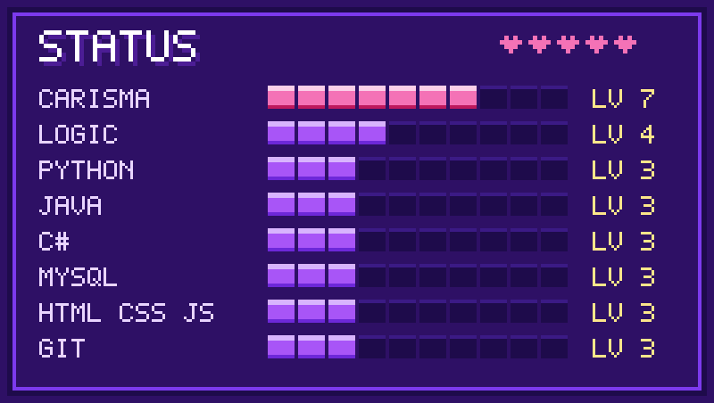
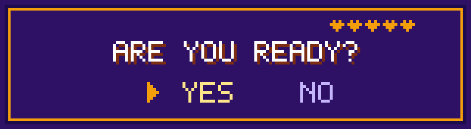

  

  
  
  

> 💬 **Karol:** *"Olá, jogador! Sou estudante de ADS e estou construindo meu caminho em desenvolvimento de software, uma fase de cada vez. Fica à vontade pra explorar meu mapa."*

 

## 🎮 FICHA DO JOGADOR

| | |
|---|---|
| 👾 **Nome** | Karol Silva Homem |
| ⚔️ **Classe** | Desenvolvedora em Formação |
| 🏰 **Guilda** | Universidade Metodista de São Paulo (ADS, 2025 – 2027) |
| 🎯 **Missão** | Primeiro estágio em desenvolvimento de software |
| 🧭 **Origem** | Atendimento ao público e rotinas administrativas em hospital |

Minha jornada antes da tecnologia me deu comunicação, organização e jogo de cintura pra resolver problema. Hoje levo isso pro código, com base em Java, Python e C#, programação orientada a objetos e banco de dados.

 

## 📊 STATUS

  

 

## 🎒 INVENTÁRIO

  
  
  
  
  
  
  
  

 

## 🗺️ FASES CONCLUÍDAS

| Fase | Missão | Itens usados | O que faz |
|:---:|---|---|---|
| 🕹️ 1 | [**Sistema de Biblioteca**](https://github.com/karol182/ProjetoBiblioteca) | C# + MySQL | App desktop em grupo para gerenciar usuários, livros, empréstimos e devoluções |
| 🕹️ 2 | [**Cadastro de Clientes**](https://github.com/karol182/sistema-cadastro-clientes-java) | Java | Cadastro de clientes aplicando Programação Orientada a Objetos |
| 🕹️ 3 | [**Classificação de Desempenho**](https://github.com/karol182/sistema-classificacao-desempenho-java) | Java | Calcula a média de notas e classifica o desempenho acadêmico de alunos |

 

## 📜 QUEST LOG

- [x] Entrar na guilda: começar ADS na Metodista
- [x] Aprender o básico: lógica de programação (Senai) e Python (Fundação Bradesco)
- [x] Lançar as 3 primeiras missões no GitHub
- [ ] **Missão atual:** conquistar o primeiro estágio em tecnologia 🎯

 

## 🏅 CONQUISTAS DESBLOQUEADAS

| | Conquista | Onde | Período |
|:---:|---|---|:---:|
| 🌟 | Jovem Aprendiz, Auxiliar Administrativa | CAMP SBC, Hospital Anchieta | 2020 – 2021 |
| 💫 | Recepcionista | Hospital de Clínicas Municipal José de Alencar | 2021 – 2023 |
| 📜 | Lógica de Programação | Senai | Curso |
| 📜 | Linguagem de Programação Python | Fundação Bradesco | Curso |

 

## 📡 PRESS START PARA CONVERSAR

  
  

  

